<p align="center">
  
</p>

<h1 align="center">MikroTik Router Analyst</h1>

<p align="center">
  <strong>Next-Generation Analytics Dashboard, Voucher Accounting & Management System for MikroTik RouterOS v6 User Manager.</strong>
</p>

<p align="center">
  <a href="https://nextjs.org/"></a>
  <a href="https://react.dev/"></a>
  <a href="https://capacitorjs.com/"></a>
  <a href="https://www.sqlite.org/"></a>
  <a href="https://mikrotik.com/"></a>
  <a href="https://github.com/hamidtholaya/mikrotik-router-analyst-v6/actions/workflows/build-apk.yml"></a>
  <a href="LICENSE"></a>
</p>

<p align="center">
  <a href="#-overview">Overview</a> •
  <a href="#-key-features">Key Features</a> •
  <a href="#-system-architecture">Architecture</a> •
  <a href="#-router-configuration">Router Setup</a> •
  <a href="#-getting-started">Getting Started</a> •
  <a href="#-mobile-app-android-apk">Mobile App</a> •
  <a href="#-custom-sql-recipes">SQL Recipes</a> •
  <a href="#-project-structure">Project Structure</a> •
  <a href="#-license">License</a>
</p>

---

## 📌 Overview

Managing MikroTik User Manager (v6) hotspots and voucher accounts directly through Winbox or CLI can be cumbersome. Out of the box, RouterOS lacks modern reporting, interactive graphical visualization, sales margin breakdowns, commission calculations, and mobile accessibility. Furthermore, executing repetitive heavy analytical queries directly on production routers can severely degrade network performance.

**MikroTik Router Analyst** solves these challenges by combining a secure synchronization engine with a high-performance analytics backend and cross-platform UI:

1. **Zero Router CPU Overhead:** Automatically synchronizes the User Manager SQLite database (`user-manager/sqldb`) to a local host via FTP. All heavy aggregation, time-series calculations, and financial reports run locally on SQLite 3 without touching the router's CPU.
2. **Dynamic Multi-Tab Analytics:** Build fully customized dashboards with drag-and-drop widgets, KPI cards, interactive Line & Bar charts, and data tables powered by custom SQL queries.
3. **Hotspot Voucher & Accounting System:** Track card sales, voucher tiers (e.g., 200 YER, 500 YER, 1000 YER, etc.), net profits, merchant commissions, and quota usage.
4. **Web & Native Android Support:** Access your network data anywhere—as a local web service or on the go via a native Android app compiled with Capacitor and automated GitHub Actions CI/CD.

---

## ✨ Key Features

### 📊 Dynamic Dashboards & Custom SQL Engine
- **Multi-Tab Layout:** Create, rename, reorder, and organize widgets across custom dashboard tabs.
- **Dynamic Widget Types:**
  - **KPI Stat Cards:** Highlight single-metric values (e.g., total cards sold, active users, total revenue).
  - **Interactive Charts:** High-performance Line and Bar charts rendered via `Chart.js` with multi-dataset and dual-axis support.
  - **Data Tables:** Display structured query results with column sorting and formatting.
- **Direct SQL Execution:** Write arbitrary SQLite statements against the active database. The built-in query runner features automatic UTF-8 sanitization for binary BLOBs and strings.
- **Widget Customization:** Customize widget title, grid size (third, half, full width), theme accents, prefix/suffix labels, and underlying SQL on the fly.

### 💰 Hotspot Sales & Voucher Analytics
- **Pre-Configured Revenue Models:** Break down sales by voucher denomination, commission deductions (e.g., 12% distributor share), and net earnings.
- **Session Analysis:** Monitor user consumption, download/upload traffic (formatted in GB/MB), and first/last session timestamps.
- **Historical Trends:** Track daily, weekly, or monthly voucher activations and sales velocities.

### 🔄 Safe Database Sync & Backup Engine
- **Automated FTP Sync:** Securely pull `sqldb` from RouterOS storage paths (such as `/user-manager/sqldb` or `/flash/user-manager/sqldb`).
- **Timestamped Backups:** Create immutable local snapshots of the database (`YYYY-MM-DD_HH-mm-ss`) before any update or sync.
- **Offline & Manual Import:** Manually upload and inspect any standalone `.db` file or switch between historical backup snapshots anytime.

### 👥 User & Session Management
- **Search & Filters:** Instant search across usernames and caller IDs, with filtering by profile, active/disabled status, and session counts.
- **Comprehensive Pagination:** Effortlessly browse through tens of thousands of voucher records.
- **Credential Visibility:** Secure toggle to show or hide user passwords with one-click clipboard copying.

### 📱 Cross-Platform Mobile Ready (Android)
- **Capacitor Integration:** Packaged into a responsive native Android APK.
- **Remote Host Configuration:** Point your mobile app to your local server or remote cloud backend with persistent API base URL management.
- **Continuous Integration (CI/CD):** Automated GitHub Actions workflow compiles signed/debug APK artifacts on every tag or push to `main`.

---

## 🏗️ System Architecture

```mermaid
flowchart LR
    subgraph RouterOS ["MikroTik RouterOS (v6)"]
        UM["User Manager Service"]
        DB[("user-manager/sqldb\n(SQLite Engine)")]
        FTP["FTP Service (:21)"]
        API["API Service (:8728)"]
        UM --> DB
        DB -.-> FTP
    end

    subgraph Backend ["MikroTik Analyst Backend (Next.js)"]
        SyncEngine["Sync Engine\n(basic-ftp)"]
        LocalDB[("Local Active DB\ndata/userman_active.db")]
        Backups[("Timestamped Backups\ndata/backups/*.db")]
        SqlRunner["SQLite Query Runner\n(sqlite3 + sanitizeRows)"]
        APIRoutes["Next.js API Routes\n(/api/userman, /api/dashboard)"]

        FTP -->|FTP Download| SyncEngine
        SyncEngine --> LocalDB
        LocalDB -->|Snapshot| Backups
        LocalDB <--> SqlRunner
        SqlRunner --> APIRoutes
        API -.->|Ping / Status| APIRoutes
    end

    subgraph Clients ["Client Interfaces"]
        WebApp["Web Dashboard\n(Next.js 14 / Chart.js)"]
        MobileApp["Android Mobile App\n(Capacitor 8)"]
        BatLauncher["MikroTik.bat\n(1-Click Windows Launch)"]

        APIRoutes --> WebApp
        APIRoutes --> MobileApp
        BatLauncher --> WebApp
    end
```



---

## ⚙️ Router Configuration

Before connecting, ensure that your MikroTik router has the **API** and **FTP** services enabled and has a user account with adequate permissions.

Run the following commands in the **RouterOS Terminal**:

```routeros
# 1. Enable API Service (default port: 8728)
/ip service enable api
/ip service set api port=8728

# 2. Enable FTP Service (required to sync user-manager/sqldb)
/ip service enable ftp
/ip service set ftp port=21

# 3. Create a dedicated group and user for MikroTik Analyst
/user group add name=analyst-group policy=api,ftp,read,write,test
/user add name=analyst group=analyst-group password="YourStrongPassword123"
```

> [!NOTE]
> If your router has a firewall filter, make sure ports `8728` (API) and `21` (FTP) are accessible from the host machine running MikroTik Analyst.

---

## 🚀 Getting Started

### Prerequisites
- **Node.js**: `v18.17.0` or higher (Node 20+ recommended)
- **npm** or **yarn** / **pnpm**
- A MikroTik Router running **RouterOS v6 with User Manager**

### Installation

1. **Clone the repository:**
   ```bash
   git clone https://github.com/hamidtholaya/mikrotik-router-analyst-v6.git
   cd mikrotik-router-analyst-v6
   ```

2. **Install project dependencies:**
   ```bash
   npm install
   ```

3. **Start the development server:**
   ```bash
   npm run dev
   ```
   Open [http://localhost:3000](http://localhost:3000) in your web browser.

4. **Production Build & Run:**
   ```bash
   npm run build
   npm run start
   ```

### ⚡ 1-Click Windows Launcher
On Windows environments, simply double-click **`MikroTik.bat`**. It will:
- Launch the Next.js server locally in the background.
- Automatically wait for server initialization.
- Open Google Chrome (or default browser) directly to [http://localhost:3000](http://localhost:3000).

---

## 📱 Mobile App (Android APK)

MikroTik Analyst comes with native Android mobile support using **Capacitor**.

### Option 1: Download Pre-Built APK via GitHub Actions
Whenever code is tagged or pushed to `main`, GitHub Actions automatically compiles the APK:
1. Navigate to the **[Actions](https://github.com/hamidtholaya/mikrotik-router-analyst-v6/actions)** tab in this repository.
2. Select the latest run of **Build Android APK**.
3. Under **Artifacts**, download `mikrotik-analyst-debug.apk`.
4. Install it on your Android device. In the app settings, configure the remote IP of your backend server.

### Option 2: Build APK Locally
```bash
# 1. Generate mobile-ready static web assets
npm run build:mobile

# 2. Synchronize assets to the Android Capacitor project
npm run cap:sync

# 3. Open in Android Studio or compile with Gradle
cd android
./gradlew assembleDebug
```
The compiled APK will be generated at:
```
android/app/build/outputs/apk/debug/app-debug.apk
```

---

## 💡 Custom SQL Recipes

Here are battle-tested SQLite queries you can use directly when adding widgets to your dashboards:

### 1. Total Cards Sold & Revenue by Denomination (Table / Bar Chart)
Categorizes cards by their username prefix (e.g., `1xxx` = 1000 YER, `5xxx` = 500 YER) and calculates sold counts, gross revenue, 12% distributor commission, and net earnings:

```sql
WITH dta AS (
  SELECT 
    u.userName,
    CASE 
      WHEN u.userName LIKE '1%' THEN '1000 YER'
      WHEN u.userName LIKE '5%' THEN '500 YER'
      WHEN u.userName LIKE '2%' THEN '200 YER'
      WHEN u.userName LIKE '3%' THEN '3000 YER'
      ELSE 'Other'
    END AS card,
    CASE
      WHEN u.userName LIKE '1%' THEN 1000
      WHEN u.userName LIKE '5%' THEN 500
      WHEN u.userName LIKE '2%' THEN 200
      WHEN u.userName LIKE '3%' THEN 3000
      ELSE 0
    END AS price,
    COUNT(s.id) AS total_sessions
  FROM user u
  LEFT JOIN session s ON s.userId = u.id
  GROUP BY u.id
)
SELECT 
  dta.card AS "Category",
  dta.price AS "Price",
  COUNT(dta.card) AS "Sold Count",
  SUM(dta.price) AS "Gross Total",
  PRINTF("%.0f", SUM(dta.price) * 0.88) AS "Net Revenue",
  PRINTF("%.0f", SUM(dta.price) * 0.12) AS "Commission (12%)"
FROM dta
WHERE dta.total_sessions > 0 AND dta.card <> 'Other'
GROUP BY dta.card

UNION ALL

SELECT 
  'Total',
  '-',
  COUNT(dta.card),
  SUM(dta.price),
  PRINTF("%.0f", SUM(dta.price) * 0.88),
  PRINTF("%.0f", SUM(dta.price) * 0.12)
FROM dta
WHERE dta.total_sessions > 0 AND dta.card <> 'Other';
```

### 2. Daily Voucher Activations (Line Chart)
Plots time-series activation counts by day:

```sql
WITH dta AS (
  SELECT 
    a.id, 
    a.userName, 
    DATE(b.fromTime, 'auto') AS ActivationDate 
  FROM user a 
  INNER JOIN (
    SELECT * FROM session GROUP BY userId
  ) b ON a.id = b.userId
)
SELECT 
  ActivationDate AS "Date", 
  COUNT(*) AS "Cards Activated"
FROM dta 
GROUP BY ActivationDate 
ORDER BY ActivationDate ASC;
```

### 3. Top 10 High-Traffic Consumers (Data Table)
Identifies the top bandwidth consumers with formatted gigabyte metrics:

```sql
SELECT 
  u.userName AS "User",
  COUNT(s.id) AS "Sessions",
  PRINTF("%.2f GB", SUM(s.bytesDownload) / (1024.0 * 1024 * 1024)) AS "Download",
  PRINTF("%.2f GB", SUM(s.bytesUpload) / (1024.0 * 1024 * 1024)) AS "Upload",
  PRINTF("%.2f GB", (SUM(s.bytesDownload) + SUM(s.bytesUpload)) / (1024.0 * 1024 * 1024)) AS "Total Traffic"
FROM user u
JOIN session s ON s.userId = u.id
GROUP BY u.id
ORDER BY (SUM(s.bytesDownload) + SUM(s.bytesUpload)) DESC
LIMIT 10;
```

---

## 📂 Project Structure

```
mikrotik-router-analyst-v6/
├── .github/
│   └── workflows/
│       └── build-apk.yml          # Automated Android CI/CD APK builder
├── android/                       # Capacitor Android native project & Gradle build
├── app/
│   ├── api/                       # Next.js App Router API endpoints
│   │   ├── auth/                  # Authentication & session verification
│   │   ├── dashboard/             # Dashboard tabs, widgets, and dynamic query execution
│   │   ├── mikrotik/              # Router connection diagnostics
│   │   └── userman/               # SQLite sync, timestamped backups & user management
│   ├── components/                # Reusable UI & Dashboard components
│   │   ├── dashboard/             # WidgetCard, AddWidgetModal, ReorderModal, Tabs
│   │   └── Navigation.jsx         # Header navigation bar & dark/light theme switch
│   ├── dashboard/                 # Analytics dashboard interface
│   ├── login/                     # Router connection & login view
│   ├── settings/                  # Database sync, backup restore & mobile host config
│   ├── users/                     # Voucher & user management table
│   ├── globals.css                # Glassmorphic cyber theme stylesheet
│   └── layout.jsx                 # Global Next.js app wrapper
├── data/                          # Local storage (created automatically)
│   ├── backups/                   # Timestamped SQLite database archives
│   ├── configs.json               # Persisted user dashboard tabs & widget configurations
│   └── userman_active.db          # Active synced SQLite database
├── public/                        # Application branding, favicons, and icons
├── scripts/
│   ├── build-mobile.js            # Build script preparing static assets for Capacitor
│   └── generate-icons.ps1         # PowerShell asset icon generator
├── capacitor.config.json          # Capacitor mobile application configuration
├── MikroTik.bat                   # 1-Click Windows execution script
├── next.config.js                 # Next.js engine configuration
└── package.json                   # Project metadata and dependencies
```

---

## 🛠️ Tech Stack

| Domain | Technologies |
| :--- | :--- |
| **Frontend Framework** | [Next.js 14](https://nextjs.org/) (App Router), [React 18](https://react.dev/) |
| **Styling & Icons** | Vanilla CSS Glassmorphism, [Lucide React](https://lucide.dev/) |
| **Data Visualization** | [Chart.js 4](https://www.chartjs.org/), [react-chartjs-2](https://react-chartjs-2.js.org/) |
| **Database & Engine** | [SQLite 3](https://www.sqlite.org/), [Knex](https://knexjs.org/) |
| **Network & Protocols** | [node-routeros](https://github.com/inaiat/node-routeros), [basic-ftp](https://github.com/patrickjuchli/basic-ftp) |
| **Mobile Runtime** | [Capacitor 8](https://capacitorjs.com/) (Android) |
| **CI / CD Pipeline** | GitHub Actions (JDK 21, Android SDK 36, Gradle) |

---

## 🔒 Security Best Practices

- **Avoid using default admin credentials:** Create a dedicated RouterOS user account restricted to API and FTP services.
- **Firewall Isolation:** Never expose your MikroTik API (`8728`) or FTP (`21`) ports to the public internet without a VPN, WireGuard tunnel, or strict IP whitelisting.
- **Local Database Safety:** The synced `data/` directory is excluded from git commits via `.gitignore` to prevent leaking sensitive router voucher details.

---

## 🤝 Contributing

Contributions are what make the open-source community an amazing place to learn, inspire, and create. Any contributions you make are **greatly appreciated**.

1. Fork the Project
2. Create your Feature Branch (`git checkout -b feature/AmazingFeature`)
3. Commit your Changes (`git commit -m 'Add some AmazingFeature'`)
4. Push to the Branch (`git push origin feature/AmazingFeature`)
5. Open a Pull Request

---

## 📄 License

Distributed under the **MIT License**. See [`LICENSE`](LICENSE) for more details.

---

<p align="center">
  Crafted with ❤️ for Network Engineers, Hotspot Operators, and the MikroTik Community.
</p>
